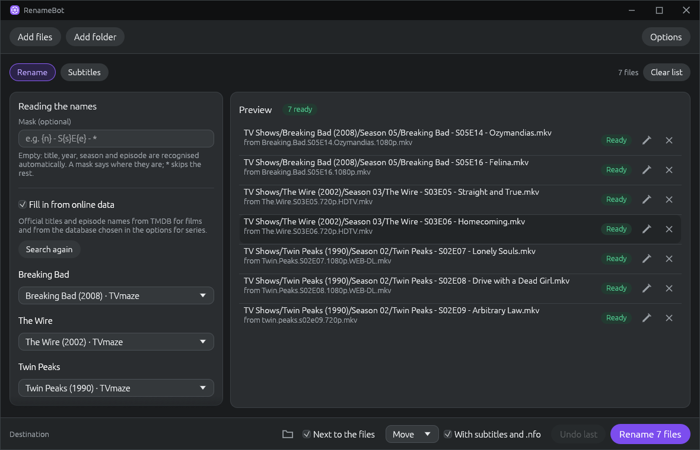
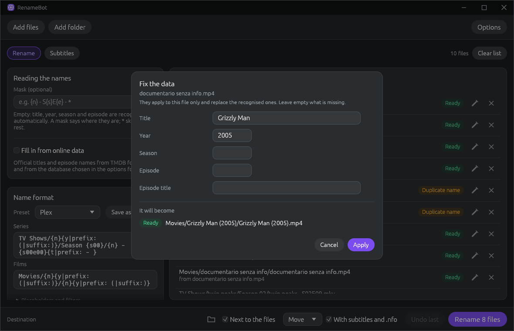
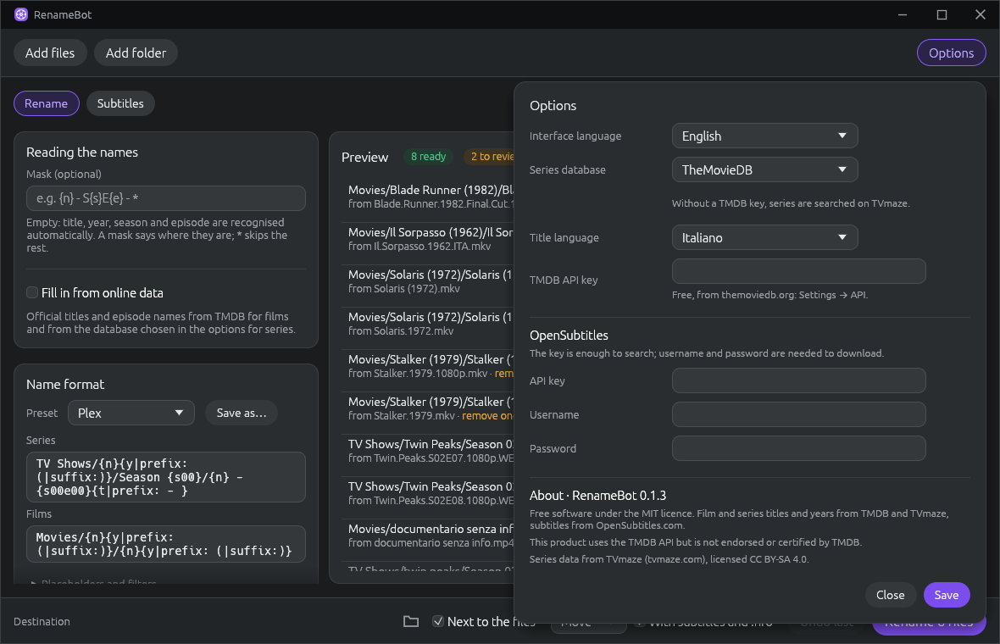

<div align="center">


# RenameBot

**Rename films and TV episodes the way your media server likes them, with a preview, an undo and subtitles. For Windows and Linux.**

[](https://github.com/echidistanti/renamebot/releases/latest)
[](https://github.com/echidistanti/renamebot/actions/workflows/ci.yml)
[](LICENSE)
[](#install)
[](https://www.rust-lang.org)



</div>

I wanted a FileBot-style renamer as a small native program: drop a season or a folder of films, check the preview, press *Rename*. RenameBot does that, and fetches subtitles too. It is a rewrite from scratch in Rust, inspired by how [FileBot Pro](https://github.com/davamudev/FileBot-Pro) behaves, with the look of my other apps [Camallo](https://github.com/echidistanti/camallo) and [Stiva](https://github.com/echidistanti/stiva). Until version 0.1.0 it was called Bobina. It is a young project, and [What I have tested](#what-i-have-tested) says plainly what has been tried.

## Features

- **Names from the file.** Title, year, season and episode are recognised from names like `Twin.Peaks.S02E07.1080p.WEB-DL.mkv` or `Blade.Runner.1982.Final.Cut.mkv`. For unusual names, a [mask](#masks) such as `{n} - S{s}E{e} - *` says where each piece is.
- **Names from the internet.** Official titles, years and episode names from [TMDB](https://www.themoviedb.org) for films and series, or from [TVmaze](https://www.tvmaze.com) for series, which needs no key at all. Files with the same title are looked up once; if the best match is wrong, pick another from the list.
- **Formats.** Placeholders and filters, `{n} - {s00e00}{t|prefix: - }`, with folders. Plex, Jellyfin and Kodi presets built in, your own saved with a name.
- **Preview.** Every file with its new name and a status: ready, unchanged, already exists, duplicate name, missing data, not recognised. A summary at the top, and the fix written in the row.
- **Fix by hand.** The pencil on a row opens the data of that one file (title, year, season, episode, episode title) and shows the name it will get.
- **Move or copy.** Folders are created as needed. Subtitles and `.nfo` files with the same name travel with the video, language tag included (`Film.it.srt`). Nothing is ever overwritten. On Windows and macOS a name can change only in its capitals.
- **Undo.** *Undo last* puts the files back and removes the folders it created, even after a restart.
- **Subtitles.** From [OpenSubtitles.com](https://www.opensubtitles.com), by file hash and by name, in the language you pick. You see the candidates (release, downloads, hash match) before downloading, and they are saved next to the video as `Name.<language>.srt`.
- **Interface** in Italian and English. It remembers its language, formats, mask and destination. `Ctrl+O` adds files; files and folders can be passed on the command line.

<table>
<tr>
<td></td>
<td></td>
</tr>
</table>

<sub>Screenshots are rendered on Linux under a virtual display, with made-up file names. The Windows window is the same.</sub>

## Install

Download from the [latest release](https://github.com/echidistanti/renamebot/releases/latest):

- **`RenameBot-<version>-setup.exe`**: installer for Windows. It asks whether to install for all users or just for you, adds a Start menu entry and, if you like, a desktop shortcut. Uninstalling leaves your settings and undo history in place.
- **`RenameBot-<version>-windows-x64.zip`**: portable, a single `renamebot.exe`.
- **`RenameBot-<version>-x86_64.AppImage`**: one file for Linux. `chmod +x` it and run it; nothing is installed.

**Requirements:** a 64-bit system and a screen that fits a window of 960 × 620.

- *Windows 11.* Windows 10 may work; I have not checked.
- *Linux, x86-64.* glibc 2.35 or newer (Ubuntu 22.04, Debian 12, Fedora 36 or later), X11 or Wayland, OpenGL (Mesa is fine), and `xdg-desktop-portal` for the file dialogs, which every mainstream desktop has. AppImages need FUSE 2 (`libfuse2`; on Ubuntu 24.04 `libfuse2t64`), or start it with `--appimage-extract-and-run`.

**Keys, only for what you use them for.** Renaming from the file name needs nothing. For films from the internet you need a free [TMDB API key](https://www.themoviedb.org/settings/api); series work without it, through TVmaze. Subtitles need an [OpenSubtitles API key](https://www.opensubtitles.com/consumers) to search and an OpenSubtitles account to download. Keys go in *Options*.

RenameBot is not code signed. See [Troubleshooting](#troubleshooting) if Windows complains.

## Using it

1. **Add files:** *Add files* (`Ctrl+O`), *Add folder* (videos in subfolders are found too), drag and drop (not in a native Wayland window), or `renamebot file-or-folder…` from the command line.
2. **Check the data.** Without a mask, names are recognised automatically. Tick *Fill in from online data* for official titles and episode names, and change a match from the list under each title if needed. For a single stubborn file, use its pencil.
3. **Pick a format:** a preset, or write your own and keep it with *Save as…*.
4. **Read the preview.** The counters at the top say how many files are ready and how many need a look; each row that needs a look says how to fix it.
5. **Choose where and how:** *Next to the files* or a folder, *Move* or *Copy*, *With subtitles and .nfo*. Then *Rename N files*.
6. **Next batch:** *Clear list*, at the top or in the *Done* bar after a rename.

| Status | Meaning | What to do |
| --- | --- | --- |
| Ready | it will be renamed as shown | nothing |
| Unchanged | the name is already right | nothing |
| Already exists | a file with that name is in the destination | change the format or the destination |
| Duplicate name | another file in the list would get the same name, e.g. two copies of a film | remove one, or make the format more specific |
| Missing `{t}` | the format needs data this file lacks | add it with the pencil, turn on online data, or make the field optional |
| Not recognised | the mask does not match this name | fix the mask, or enter the data with the pencil |

## Name formats

A format is the path of the new name, without the extension; `/` makes folders. Series and films have a format each.

| Placeholder | Becomes |
| --- | --- |
| `{n}` | title of the film or series |
| `{y}` | year |
| `{s}` `{e}` | season and episode: `2`, `7` |
| `{s00}` `{e00}` | the same with two digits: `02`, `07` |
| `{s00e00}` | `S02E07` |
| `{sxe}` | `2x07` |
| `{t}` | episode title |

Filters follow a `|`: `upper`, `lower` and `title` change capitals; `default:text` is used when the value is missing; `prefix:text` and `suffix:text` add text only when the value exists, and make the field optional. `{y|prefix: (|suffix:)}` gives `Twin Peaks (1990)`, or just `Twin Peaks` without a year. Characters that file systems refuse (`: * ? " < > |` and slashes inside a value) are removed or replaced.

The presets:

| Preset | Series | Films |
| --- | --- | --- |
| Plex | `TV Shows/{n}{y\|prefix: (\|suffix:)}/Season {s00}/{n} - {s00e00}{t\|prefix: - }` | `Movies/{n}{y\|prefix: (\|suffix:)}/{n}{y\|prefix: (\|suffix:)}` |
| Jellyfin | `Shows/{n}{y\|prefix: (\|suffix:)}/Season {s}/{n} S{s00}E{e00}{t\|prefix: - }` | as Plex |
| Kodi | `TV Shows/{n}/Season {s}/{n} - {s00e00}{t\|prefix: - }` | as Plex |

With Plex, `Twin.Peaks.S02E07.1080p.WEB-DL.mkv` becomes `TV Shows/Twin Peaks (1990)/Season 02/Twin Peaks - S02E07 - Lonely Souls.mkv` once the online data is in.

## Masks

A mask describes the current name, without the extension, when automatic recognition gets it wrong. `{n}` and `{t}` take any text, `{y}` four digits, `{s}` and `{e}` a number; `*` skips anything; everything else must match as written, ignoring capitals. Dots become spaces in the title unless it already has spaces, so `Mr. Robot` stays as it is.

| Mask | Name | Result |
| --- | --- | --- |
| `{n} - S{s}E{e} - {t}` | `Twin Peaks - S02E07 - Lonely Souls` | title, season 2, episode 7, episode title |
| `{n}.{y}.*` | `Blade.Runner.1982.1080p.BluRay.x264` | `Blade Runner`, 1982 |
| `{n} {s}x{e}*` | `The Wire 3x05 720p` | `The Wire`, season 3, episode 5 |

## Online data

- **Films** come from TMDB. **Series** come from the database chosen in *Options*: TMDB, or TVmaze. Without a TMDB key, series go to TVmaze on their own.
- Files with the same title form one group and are searched once. The best match prefers the year in the file name; the list under the title holds the others.
- Episode titles come per season. A season the database does not know (often season 0, the specials) is skipped, and the others still get their titles.
- TMDB titles follow the *Title language* option (Italian or English) and fall back to the original; TVmaze titles are in English.
- Answers are kept on disk for seven days, so going back to the same series costs no new requests.

## Subtitles

1. In the *Subtitles* tab, pick a language (Italian, English, French, German, Spanish, Brazilian and European Portuguese, Russian, Japanese, Simplified Chinese).
2. *Search subtitles* looks for every file by its hash (the most precise match) and by title, season and episode or year. Results with a matching hash come first.
3. Each file shows its candidates: release name, language, downloads, `✓ hash` for an exact match, `HI` for the hearing impaired. Untick what you do not want.
4. *Download N subtitles* saves them next to the videos as `Name.<language>.<extension>`, as they come, without converting the text. An existing file is never overwritten.

Free OpenSubtitles accounts have a daily download limit; RenameBot says so when it is reached. Data fixed with the pencil is used for the search too.

## Undo and safety

- Nothing is overwritten: not by a rename, not by a subtitle, not by an undo. A conflict stops that one file and is reported.
- Moving between drives copies and then deletes the original; if the delete fails, the copy is removed again, so you never end up with two files.
- *Undo last* takes back the whole last operation, linked files included, and removes the folders it had created once they are empty. If a file has meanwhile come back to its old place, undo leaves both alone and says so.
- The history keeps the last 50 operations and is saved while the work is running, so it survives a crash or a restart. Two RenameBot windows open at once share it.
- Long moves run in the background with a progress bar; the window stays usable.

## Data and privacy

| | Windows | Linux |
| --- | --- | --- |
| Settings (`config.json`) and undo history (`history.json`) | `%APPDATA%\RenameBot` | `~/.local/share/RenameBot` |
| Online answers (seven days) | `%LOCALAPPDATA%\RenameBot\http` | `~/.cache/RenameBot/http` |

API keys and the OpenSubtitles password are stored as plain text in `config.json`; on Linux the file is readable only by you. Settings from Bobina are moved over on the first start.

No accounts of its own, no telemetry, no update check. RenameBot connects to `api.themoviedb.org`, `api.tvmaze.com` and `api.opensubtitles.com` (and the download link OpenSubtitles hands back) only when you turn on online data or search and download subtitles.

## What I have tested

I use RenameBot on my own collection. With TMDB data it matched and renamed a real folder correctly, and series get their episode titles from TVmaze, including without a TMDB key.

**Not tried yet against the real service: downloading subtitles from OpenSubtitles.** Search, login and download are covered by tests against recorded answers, but I have not looked at a subtitle it fetched. A report is the most useful thing you can send me.

About seventy automated tests run on Linux and Windows on every push: name recognition, masks, formats, the preview and its conflicts, moving and undoing on real files in temporary folders (two seasons at once, linked subtitles, a failed move, a name that changes only in its capitals on Windows), the history shared by two windows, and the TMDB, TVmaze and OpenSubtitles clients against recorded answers. The window is checked under a virtual display on Linux.

## Troubleshooting

- **SmartScreen or Defender warns.** RenameBot is new and unsigned. SmartScreen: *More info → Run anyway*. The source is here and `cargo build --release` produces the same program.
- **Dropping files on the window does nothing (Linux).** On Wayland the window library does not pass dropped files on. Use *Add files* or *Add folder*, which always work.
- **The AppImage does not start (Linux).** Most often FUSE 2 is missing: install `libfuse2` (`libfuse2t64` on Ubuntu 24.04), or run it with `--appimage-extract-and-run`. If a file dialog never opens, your desktop lacks `xdg-desktop-portal`; install the one for it.
- **"TMDB key missing" next to a film.** Films need a TMDB key; add it in *Options*. Series do not.
- **"Not recognised".** The mask does not match that name: empty the mask to go back to automatic recognition, or use the pencil.
- **"Duplicate name".** Usually two copies of the same film or episode. Remove one with its ✕.
- **A file is not moved and the error says it is in use (Windows).** Close the player that has it open and rename again; nothing has been copied or lost.
- **Online data looks out of date.** Answers are kept for seven days; delete the `http` folder from the table above to fetch them again.
- **"Daily download limit reached".** OpenSubtitles counts downloads per account per day; wait for the reset or use another account.

## Building from source

Rust 1.88 or newer.

```sh
cargo run -- ~/Downloads          # debug build, optionally with files or folders to open
cargo test                        # the tests; no network needed
cargo clippy --all-targets -- -D warnings
cargo build --release             # target/release/renamebot(.exe)
```

On Ubuntu, CI installs `libxkbcommon-dev`, `libwayland-dev` and `libgl1-mesa-dev` before building. On Windows, the icon goes into the exe through `rc.exe` from the Windows SDK; without it the program builds anyway, without an icon.

**Releases are built by GitHub.** *Actions → Release → Run workflow*, with the version: `release.yml` builds the Windows exe, the [Inno Setup](https://jrsoftware.org/isinfo.php) installer and the zip on a Windows runner, the AppImage on Ubuntu 22.04, and attaches all three to a draft release. Publishing the draft creates the tag. `ci.yml` runs Clippy and the tests on Linux and Windows on every push to `main`.

## Project layout

| Path | Contents |
| --- | --- |
| `src/main.rs`, `app.rs`, `ui.rs` | the window, its screens and state; widgets and colours (egui) |
| `src/template.rs`, `mask.rs`, `guess.rs` | name formats, masks, recognising names |
| `src/plan.rs`, `ops.rs` | the preview and its conflicts; moving, copying, linked files, undo history |
| `src/metadata.rs`, `subs.rs`, `http.rs` | TMDB and TVmaze; OpenSubtitles; HTTP with the disk cache |
| `src/config.rs`, `i18n.rs`, `error.rs`, `fsx.rs` | settings and presets; every text in Italian and English; errors; safe file writes |
| `assets/`, `docs/` | the icon (SVG source, PNG, ICO); screenshots |
| `packaging/`, `build.rs`, `.github/workflows/` | Inno Setup script and Linux desktop entry; the exe icon; CI and release |

## Contributing

Bug reports are welcome. Please include the RenameBot version, your system (Windows version, or Linux distribution and desktop, X11 or Wayland), what you did and expected, and a few of the file names involved, with anything private removed. For a pull request, keep it small and make sure `cargo fmt`, Clippy and the tests pass, and add any user-visible text to `src/i18n.rs` in both languages.

## Known limits

- Not code signed. No macOS build yet.
- Sources are TMDB, TVmaze and OpenSubtitles only: no TheTVDB, no AniDB.
- Anime with absolute episode numbers are not understood; season and episode are. A file holding two episodes (`S01E01E02`) is named after the first.
- TVmaze titles are in English only.
- The command line opens files in the window; there is no renaming without the window.
- Linux: dropping files on the window does not work under native Wayland, and the window is drawn by RenameBot (title bar included), not by the desktop.

## Credits

This product uses the TMDB API but is not endorsed or certified by TMDB. Film and series data from [The Movie Database](https://www.themoviedb.org).

Series data from [TVmaze](https://www.tvmaze.com), licensed [CC BY-SA 4.0](https://creativecommons.org/licenses/by-sa/4.0/). Subtitles from [OpenSubtitles.com](https://www.opensubtitles.com).

Built with [egui](https://github.com/emilk/egui), [rfd](https://github.com/PolyMeilex/rfd), [ureq](https://github.com/algesten/ureq), [serde](https://serde.rs), [regex](https://github.com/rust-lang/regex), [dirs](https://github.com/dirs-dev/dirs-rs), [winresource](https://github.com/BenjaminRi/winresource), [Inno Setup](https://jrsoftware.org/isinfo.php) and [appimagetool](https://github.com/AppImage/appimagetool). The behaviour is inspired by FileBot and [FileBot Pro](https://github.com/davamudev/FileBot-Pro); no code from them is used.

## Licence

MIT. See [LICENSE](LICENSE).
