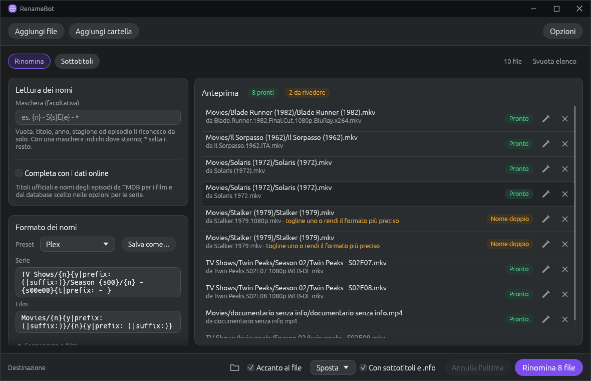
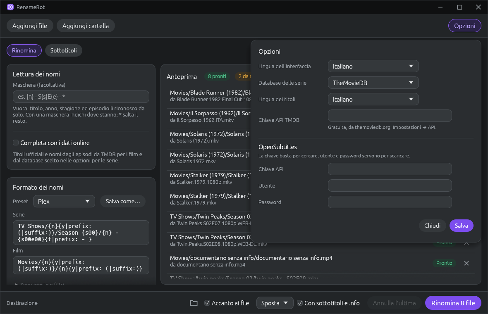

# RenameBot

*Fino alla versione 0.1.0 si chiamava Bobina.*

Rinominatore di film e serie TV con anteprima, scritto in Rust con GUI nativa (egui).
Windows e Linux subito, macOS in seguito. Riscrittura indipendente, ispirata al comportamento di FileBot Pro.

## Stato

Scheletro funzionante:

- Template dei nomi con segnaposto e filtri: `{n}{y|prefix: (|suffix:)}`
- Maschere a segnaposto sul nome attuale: `{n} - S{s}E{e} - *`
- Riconoscimento automatico di titolo, anno, stagione ed episodio dal nome file
- Anteprima con riepilogo e conflitti evidenziati (esiste già, nome doppio, dati mancanti), ognuno con il rimedio scritto nella riga
- Correzione a mano dei dati di un singolo file (titolo, anno, stagione, episodio, titolo dell'episodio) con la matita, e anteprima del nome che ne risulta
- Applica (sposta/rinomina o copia) in background con barra di avanzamento; file collegati (`.srt`, `.ass`, `.nfo`…, con etichette di lingua come `.it` o `.pt-BR.forced`) che seguono il video; mai sovrascritture; su Windows e macOS si possono cambiare anche solo le maiuscole
- Annulla persistente (registro in `history.json` nella cartella dati utente, salvato durante il lavoro e condiviso tra più finestre), ultimi 50 lotti
- Riconoscimento online (TMDB per film e serie, TVmaze per serie): ricerca per gruppo di file, miglior candidato scelto anche per anno, elenco per cambiare scelta, titoli degli episodi; cache su disco di 7 giorni
- Impostazioni in `config.json` nella cartella dati utente: chiavi, database, lingua dei metadati, lingua dell'interfaccia, maschera, formati, destinazione e preset personali, ripresi al riavvio
- Sottotitoli da OpenSubtitles.com: ricerca per hash del file e per nome nella lingua scelta, anteprima dei candidati (release, scaricamenti, corrispondenza hash), download accanto al video come `Nome.<lingua>.srt`, mai sovrascrivere. Servono chiave API, account e password nelle impostazioni
- Preset Plex, Jellyfin, Kodi più preset personali; interfaccia ed errori in italiano e inglese; drag and drop

I client TMDB, TVmaze e OpenSubtitles sono testati su risposte registrate e vanno ancora provati dal vivo con le chiavi.

## Opzioni

Chiavi API, database delle serie e lingue stanno nel pannello Opzioni, in alto a destra.

## Linux

I dialoghi «Aggiungi file/cartella» usano xdg-desktop-portal: su desktop senza portale resta il trascinamento.
Sotto Wayland nativo il trascinamento può non funzionare (limite della libreria delle finestre): in quel caso usa i pulsanti.

## Release

La CI (`.github/workflows/ci.yml`) compila e lancia i test su Linux e Windows a ogni push su `main`.
`release.yml` crea una release in bozza con installer e zip per Windows e AppImage per Linux. Si avvia a mano da Actions → Release → Run workflow, indicando la versione (es. `0.1.1`); il tag nasce quando si pubblica la bozza.

## Sviluppo

    cargo test
    cargo run

## Licenza

MIT
